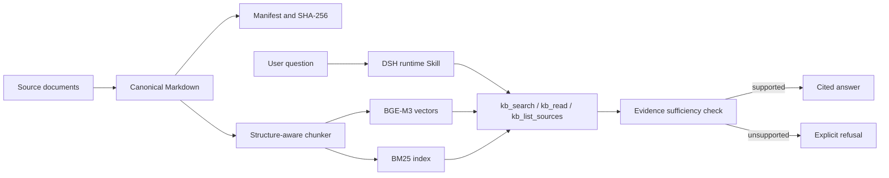

# Architecture

## System Goal

`dsh-evidence-agent` is a source-backed Agentic RAG plugin for DeepSeek Harness.
It answers from a local technical corpus, returns citations tied to real
document lines, and refuses when the corpus does not support an answer.

The generative and embedding models are pretrained. This project does not train
model weights.

## Data Flow



## Components

| Component | Responsibility |
| --- | --- |
| `knowledge/sources.json` | Source catalog, URLs, licenses, and local paths |
| `lib/knowledge-manifest.js` | Stable manifest and SHA-256 verification |
| `lib/chunker.js` | Heading-aware chunks with real line ranges |
| `lib/embedding-client.js` | OpenAI-compatible embedding client |
| `lib/vector-store.js` | JSONL dense-vector persistence |
| `lib/bm25.js` | Mixed English/Chinese lexical index |
| `lib/retrieval.js` | Dense search, BM25 search, and RRF fusion |
| `lib/evidence-plugin.js` | Tool schemas, runtime budget, and rendering |
| `skills/dsh-evidence-agent/SKILL.md` | Agent routing, evidence, citation, and refusal policy |
| `eval/` | 60-question retrieval and answer benchmarks |

## Request Lifecycle

1. The model reads the runtime Skill.
2. It decides whether the request needs corpus evidence.
3. A single-hop question normally performs one Hybrid search.
4. A multi-hop question may use multiple focused queries.
5. `kb_read` loads adjacent chunks when a hit lacks context.
6. The model checks whether each material claim has direct support.
7. Answers use `[doc_id#Lstart-Lend]` citations from tool results.
8. Insufficient evidence produces an explicit refusal.

## Runtime Invariants

- Every evidence tool shares a hard four-call budget per user turn.
- `budget_remaining` is visible in every normal tool result.
- The fifth evidence call is rejected without touching the indexes.
- Tool outputs use strict JSON schemas.
- Search has timeout, cancellation, retry, and degraded-mode handling.
- Corpus text is data, never a system instruction.
- Citations cannot use model-generated line numbers outside tool output.

## Retrieval Trade-offs

BM25 is cheap and precise for names and terms. BGE-M3 adds semantic recall.
RRF combines their ranks without assuming comparable raw score scales.

The current vector store scans JSONL vectors directly. This design is simple and
reproducible for a small local corpus. A production-sized corpus needs ANN
indexing, sharding, and an external vector database.

## Evaluation Flow

```mermaid
flowchart LR
    QS[60 questions] --> RET[Retrieval baselines]
    QS --> GEN[No RAG / Dense / Hybrid / Agentic answers]
    RET --> RM[Recall@5, HitRate@5, MRR@5]
    GEN --> DJ[Deterministic citation and refusal checks]
    GEN --> LJ[Correctness and faithfulness labels]
    RM --> REPORT[Reports]
    DJ --> REPORT
    LJ --> REPORT
```

The automated judge is provisional. A public benchmark claim requires human
adjudication or an independently calibrated judge.
